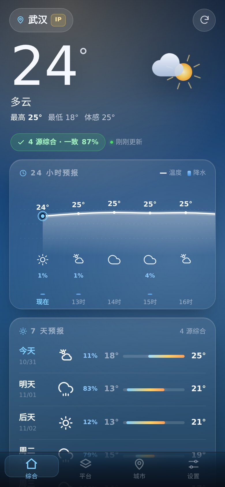
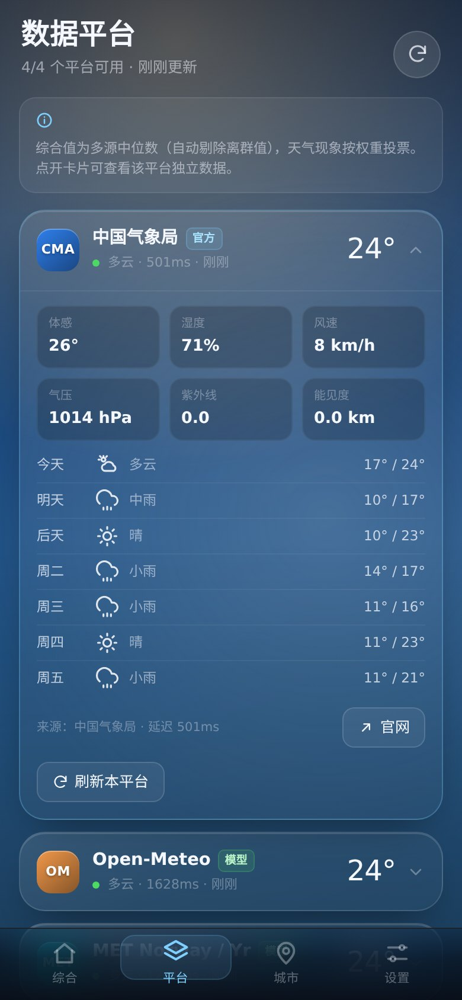
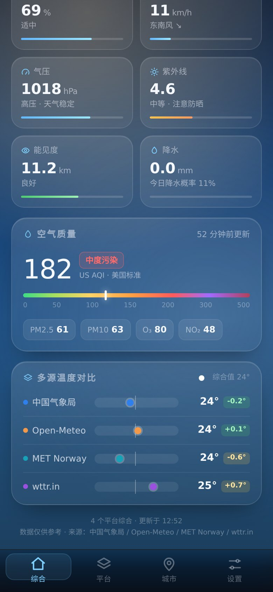
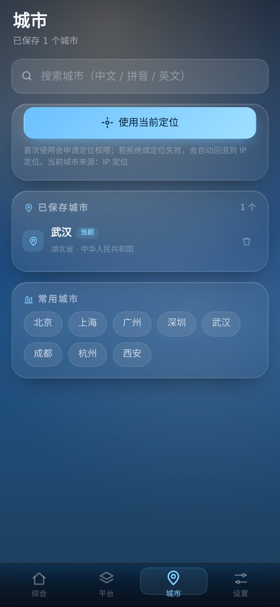

# 天气汇 · WeatherHub

[](https://developer.android.com)
[](#-构建)
[](#-构建)
[](LICENSE)

一个 **多源天气聚合 Android App**：自动获取当前城市，同时从 **4 个天气平台**（中国气象局、Open-Meteo、MET Norway、wttr.in）抓取数据，给出 **综合结论** 与 **各平台独立详情**，并附空气质量与气象预警。

<p align="center">
  
  
</p>
<p align="center">
  
  
</p>

> 更多截图：[综合页](docs/screenshots/home.jpg) · [指标与多源对比](docs/screenshots/home-detail.jpg) · [数据平台](docs/screenshots/sources.jpg) · [平台详情展开](docs/screenshots/sources-expanded.jpg) · [城市](docs/screenshots/cities.jpg) · [搜索](docs/screenshots/search.jpg) · [设置](docs/screenshots/settings.jpg)

## 📲 下载安装

- **APK**：[dist/WeatherHub-1.0.0.apk](dist/WeatherHub-1.0.0.apk)（约 165 KB，已签名）· 或从 [Releases v1.0.0](https://github.com/mdktelmdktel/weatherhub/releases/tag/v1.0.0) 下载
- 支持 Android 6.0+（minSdk 23 / targetSdk 34），无需 Google 服务
- 安装时如提示"未知来源"，在系统设置里允许本次安装即可
- SHA-256：`771cd10f1ecfba4461dd848fafb56c58e8599009326abbe44cadc7b7f42cce44`

## ✨ 功能

### 自动定位
- 原生 **GPS**（运行时权限）→ **IP 定位**多源兜底（ipinfo / ipwho.is / api.ipapi.is）→ 上次城市 → 默认武汉
- 中文城市搜索：中国气象局站号库 + Open-Meteo Geocoding，支持中文 / 拼音 / 英文
- 已保存城市列表与常用城市快捷切换

### 多源天气
| 平台 | 类型 | 提供 |
|---|---|---|
| 中国气象局（CMA） | **官方** | 实况、7 天预报、气象预警（站号数据） |
| Open-Meteo | 模型 | ECMWF/GFS 逐小时、7 天、日出日落、UV |
| MET Norway（Yr） | 模型 | 逐小时全球预报 |
| wttr.in | 聚合 | World Weather Online 数据（3 天 + 逐 3 小时） |
| 和风天气 / OpenWeatherMap | 可选 | 在设置里填自己的 API Key 后启用 |

### 综合算法
- 温度 / 体感 / 湿度 / 风速 / 气压 / UV / 能见度 / 降水：多源 **中位数**，自动剔除离群值
- 天气现象：**加权投票**（官方源权重更高）
- 输出 **一致度百分比**（高/中/低分歧提示）、各源与综合值的偏差对比
- 24 小时逐时温度曲线、降水概率柱；7 天高低温区间条 —— 均为跨源对齐后合并
- 空气质量（CAMS · US AQI / PM2.5 / PM10 / O₃ / NO₂）与 CMA 气象预警

### 各平台独立详情
- 每个平台独立卡片：当前天气、体感、湿度、风速、气压、UV、能见度
- 该平台自己的逐时与 7 天预报
- 请求延迟、更新时间、单源刷新/重试、跳转官网
- **单源失败不影响整体**，失败卡片自动展开显示原因与重试入口

### 体验
- 深色玻璃拟态、随天气/昼夜变化的动态背景（晴/夜/雨/雪/雷/雾/沙尘 CSS 绘制）
- 大号温度滚动、SVG 平滑曲线、7 天温度区间条、下拉刷新、骨架屏、离线缓存与过期提示
- 数字/卡片入场动画、安全区适配、360–430px 全宽度自适应、无外部资源与 CDN

## 🧱 技术架构

```
┌──────────────────────────── Android WebView（https://app.local）────────────────────────────┐
│  原生 JS 单页应用（app/，零依赖零构建）                                                    │
│  bridge.js → sources.js → aggregate.js → location.js → ui.js → app.js                     │
│        │ window.AndroidApp（@JavascriptInterface）                                         │
│  ┌─────▼──────────────────────────────────────────────────────────────────────────────┐    │
│  │ MainActivity / NativeBridge / AssetServer（纯 Java，无 AndroidX / 无 Gradle）        │    │
│  │  · HttpURLConnection 异步请求（4 线程池 / 超时 / 重定向 / 2MB 上限）                 │    │
│  │  · LocationManager 定位 + 运行时权限续接                                            │    │
│  │  · shouldInterceptRequest 从 assets 提供静态资源（正确 MIME / UTF-8）               │    │
│  │  · 白屏守卫 / JS 错误页 / 隐藏调试面板（顶部连点 5 次或长按）                        │    │
│  └───────────────────────────────────────────────────────────────────────────────────┘    │
└────────────────────────────────────────────────────────────────────────────────────────────┘
```

- 前端 **零依赖、零构建**：普通 `<script>` 顺序加载，内联 SVG 图标与图表，全部资源打包进 APK，离线可打开。
- 网络请求全部走 **原生桥**，天然绕开 WebView CORS 限制，并能自定义 UA / 超时 / 重试。
- 构建完全手写：`aapt`(v1) → `javac` → `d8`(R8) → `zipalign` → `apksigner` —— **不需要 Android SDK / Gradle**，可在手机上的 aarch64 Ubuntu（proot）里直接完成构建。

## 📁 目录结构

```
app/                     # 打进 APK 的 Web 资源（无构建步骤）
  index.html
  css/style.css          # 深色玻璃拟态 + 天气背景动画
  js/bridge.js           # 原生桥封装 / 缓存 / 设置 / 图标 / 格式化
  js/sources.js          # 6 个平台适配器 + 统一模型
  js/aggregate.js        # 多源中位数 + 天气现象投票 + 一致度
  js/location.js         # GPS / IP 定位 + 城市搜索
  js/ui.js               # 渲染层（页面 / 图表 / 组件）
  js/app.js              # 控制器（状态 / 路由 / 刷新 / 设置）
android/                 # 原生壳
  AndroidManifest.xml
  src/com/deepseek/weatherhub/{MainActivity,NativeBridge,AssetServer,DebugPanel}.java
  res/  keystore/
build.sh                 # 一键构建签名 APK
tools/                   # 图标生成 / 预览服务器 / 截图 / GitHub 发布脚本
tests/                   # 数据层 / UI 冒烟测试（headless Chromium）
docs/screenshots/        # 截图
dist/                    # 已签名 APK
```

## 🔨 构建

依赖（Ubuntu/Debian aarch64 或 x86 均可，无需 Android SDK）：

```bash
sudo apt-get install -y openjdk-17-jdk-headless aapt zipalign apksigner unzip zip curl
sudo apt-get install -y android-sdk-platform-23          # 提供 android.jar（API 23 即可编译）
# d8 来自 Maven 的 r8.jar（apt 没有 aarch64 d8）；build.sh 会自动下载到 tools/lib/
curl -L -o tools/lib/r8.jar \
  https://maven.aliyun.com/repository/google/com/android/tools/r8/8.9.35/r8-8.9.35.jar
```

```bash
./build.sh                # → build/WeatherHub-1.0.0.apk
apksigner verify --print-certs build/WeatherHub-1.0.0.apk
aapt dump badging build/WeatherHub-1.0.0.apk | head
```

## 🧪 本地预览 / 测试

```bash
npm i -D playwright-core
PLAYWRIGHT_DOWNLOAD_HOST=https://cdn.npmmirror.com/binaries/playwright \
  node node_modules/playwright-core/cli.js install chromium-headless-shell

node tools/dev-server.mjs     # http://127.0.0.1:8099/?proxy=1（真实数据，带 CORS 代理）
node tools/dev-server.mjs     # http://127.0.0.1:8099/?mock=1  （离线 mock 数据）
node tools/screenshot.mjs     # 4 个 Tab 截图 → build/shots/
node tests/ui-smoke.mjs       # UI 冒烟：console error / 横向溢出 / Tab / 失败重试（18 项）
node tests/core-test.mjs      # 数据层单测（80 项）
node tests/fetch-sources.mjs  # 真实抓取 4 个平台并验证归一化与聚合（105 项）
```

当前测试结果：`core-test 80/80 ✅`、`fetch-sources 105/105 ✅`、`ui-smoke 18/18 ✅`（headless Chromium，390/412/360 三档宽度）

## 🙏 数据来源

- [中国气象局 · 天气网](https://weather.cma.cn/)（官方数据）
- [Open-Meteo](https://open-meteo.com/)（CC BY 4.0）· [空气质量 CAMS](https://open-meteo.com/en/docs/air-quality-api)
- [MET Norway · Yr](https://www.met.no/en)（NLOD / CC BY 4.0）
- [wttr.in](https://wttr.in/)（World Weather Online）
- [ipinfo.io](https://ipinfo.io/) · [ipwho.is](https://ipwho.is/) · [ipapi.is](https://api.ipapi.is) · [BigDataCloud](https://www.bigdatacloud.com/)（IP 定位 / 逆地理）
- 城市站号：中国气象局 `/api/autocomplete`；地理编码：Open-Meteo Geocoding

数据版权归各平台所有，本应用仅做聚合展示，不存储用户数据。

## 🔒 隐私

- 无账号、无后端、无广告、无统计埋点
- 定位只在本机解析（GPS 坐标仅用于查询天气平台，不上传到自有服务器）
- 可选 API Key 仅保存在本机 WebView localStorage

## 📄 License

[MIT](LICENSE)

[](https://github.com/deepseek-ai/deepseek-harness)
